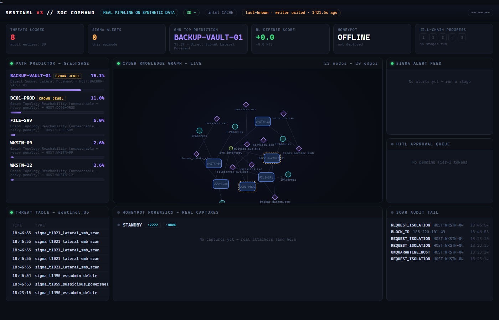

<div align="center">
  
  
  
  
  

  <h1>🛡️ Sentinel V3 </h1>
  <p><b>Autonomous AI Security Operations Center (SOC) Proof of Concept</b></p>
</div>

<br/>

## 📖 Overview
**Sentinel V3** is a Blue Team defense demo architecture. It combines **NetworkX threat graphing** for lateral movement prediction with the cognitive reasoning of **Large Language Models (Hermes/Gemini)** via an MCP interface to achieve Human-in-the-Loop (HITL) Security Orchestration, Automation, and Response (SOAR).

Everything here runs against a **simulated lab network only**. Nothing in this repo touches a real network, real host, or real account.

## 🏗️ Architecture

```
Simulated lab telemetry
        │
        ▼
  watcher.py ──► Laya System-1 triage gate ──► LLM reasoning (Hermes/Gemini, MCP)
  (ingest)        (auto-act > 0.85,                (threat-path explanation,
                    escalate below)                  containment recommendation)
        │                                                │
        ▼                                                ▼
  NetworkX threat graph ◄── GraphSAGE link prediction ──┤
  (lateral movement forecast)                            │
        │                                                ▼
        │                                   SOAR engine ──► Telegram HITL approval
        │                                   (isolate / block / unquarantine)
        ▼
  dashboard/ (live SOC command view, 127.0.0.1:8515)
  honeypot_service (real TCP listeners, forensics)
```

Key components:

- `backend/triage/laya_triage_engine.py` — **Laya System-1 triage**: a fine-tuned local classifier scores every event in milliseconds, predicts lateral paths, and dispatches the deceptive honeypot. Loads the trained `laya-tuned-v1` weights with warmup at boot.
- `backend/gnn/` — two-stage pipeline: NetworkX feature extraction → GraphSAGE/GNN link prediction for lateral movement (`predictor.py`, `model.py`).
- `backend/reasoning/hermes_soc_lead.py` — LLM reasoning layer (canned keyword replies with a live API gateway fallback; probabilities are computed from the live telemetry graph, never hardcoded).
- `backend/containment/soar_engine.py` — SOAR actions with 256-bit HITL tokens delivered via Telegram, masked tokens in state/UI, 3-attempt lockout.
- `backend/intel/threat_intel.py` — threat-intel enrichment with strict IP validation and a 7-day cache prune.
- `mcp_server/server.py` — the unified MCP server: **18 registered tools**, all dispatched through `call_tool` (thread-safe, `threading.Lock`).
- `dashboard/` — live SOC command view. Binds `127.0.0.1` only; all mutating endpoints (`/api/run_stage`, `/api/reset`, `/api/honeypot`, `/api/approve`) require the `X-Sentinel-Token` session header.

## 🖥️ Dashboard (live)



*Live run, stages 1–3: 7 threats logged, 7 Sigma alerts, GNN top prediction FILE-SRV at 45%, 29-node / 29-edge threat graph, kill-chain 3 of 5 stages, HITL approval queue with masked token.*

Run it:

```bash
python dashboard/server.py --port 8515
# open http://127.0.0.1:8515/
```

Run an APT stage through the pipeline (needs the session token from the served page):

```bash
curl -X POST http://127.0.0.1:8515/api/run_stage \
  -H "X-Sentinel-Token: <session-token>" \
  -H "Content-Type: application/json" \
  -d '{"stage": 2}'
```

## 🔒 Security hardening (verified)

Independent security review + fix rounds (Oct 2026) closed, among others:

- Dashboard binds loopback only, session-token auth + rate limiting on mutating endpoints (§2.1).
- 256-bit HITL tokens, Telegram-only delivery, masked in UI and state, attempt lockout (§2.2).
- Shell-command injection closed via strict `ipaddress` validation (§2.3).
- Episode reset preserves the SQLite audit trail (§2.4).
- Probability computed from live telemetry; an honest `UNKNOWN_HOST / 0.0` sentinel is returned when GNN inference is unavailable (§2.5). Note: `BACKUP-VAULT-01` still appears as a default target name in two fallback spots — tracked, not hidden.
- Exact process-name matching for the false-positive whitelist (§2.6).
- Threat-intel cache pruned to 7 days; Cypher identifiers allow-listed (§2.8, §2.9, §2.16).
- Salted SHA-256 honeypot credentials, redacted in UI (§2.11).
- Incident reports HTML-escaped, CRLF stripped from WAF rules; reports centralised under gitignored `var/reports/` (§2.12, §2.13).
- SQLite WAL, ledger untracked with `.bak` quarantine, unquarantine path registered, `>=` thresholds, 18-tool registry with a thread-safe dispatch (§2.14, §2.17, §2.19, §2.20, §2.21).
- GNN directed adjacency, per-instance RNG (no global seed contamination), graph-version cache invalidation, coordinate-specific Q-learning loss, realistic multi-hop simulator topology (§2.22–§2.28).

## 🧪 Tests

```bash
python -m pytest tests/
# 25 passed — 18 suite + 4 Laya integration + 3 security hardening
```

The suite includes a dispatch test that calls `call_tool` once per registered tool, so a missing handler can never again slip through silently (a real regression caught this way in Oct 2026).

## 🤖 Laya training proof (RTX 4050)

Laya is the fine-tuned triage model behind the System-1 gate. Training proof screenshots (redacted):


Held-out evaluation (`evaluate.py` base-vs-tuned on the 105 held-out rows + `EVAL.md`) is the outstanding step — no benchmark numbers are claimed until it exists.

## ⚠️ Disclaimer
Demo / educational proof of concept. Simulated lab network only. Not a production SOC, not a weapon — every offensive capability in the simulator is paired with its detection telemetry and remediation.
